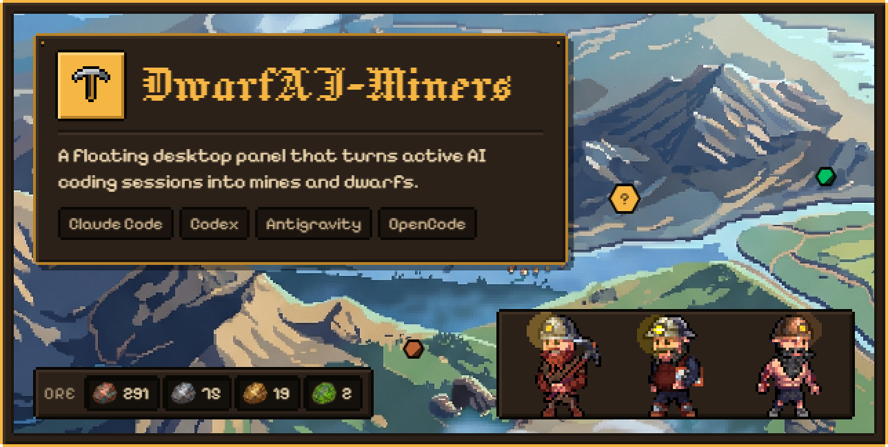
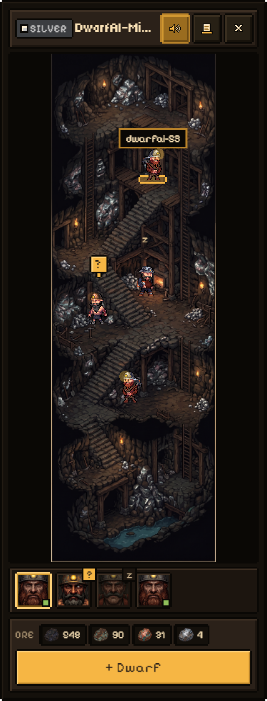
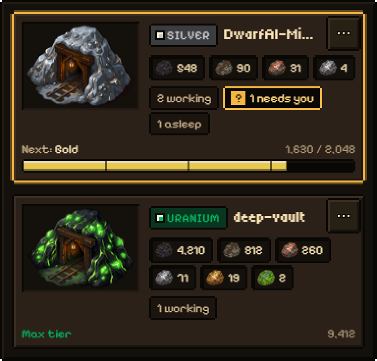
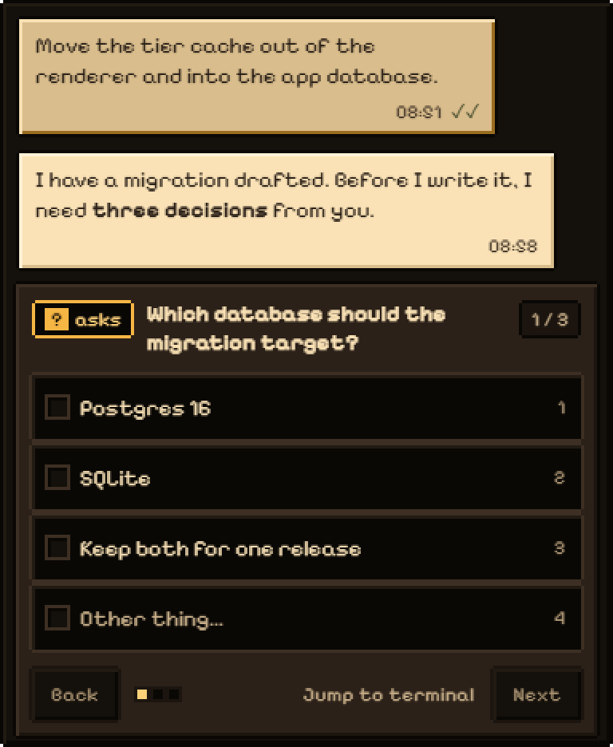
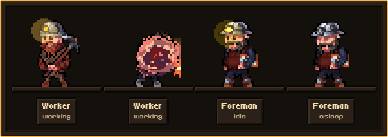

<p align="center">
  
</p>

<div align="center">

[](https://github.com/JeronimoRepetto/DwarfAI-Miners/actions/workflows/ci.yml)
[](LICENSE)

[](https://ko-fi.com/jeronimorepetto)


</div>

DwarfAI-Miners shows the AI coding sessions on your computer as dwarfs working in mines. A **mine**
is one project folder; a **dwarf** is one AI coding session in it, ranked foreman, worker or
worker2 by how deep it sits below the mine's root session.

It is an **observer**: start Claude Code, Codex, OpenCode or Antigravity in your own terminal, and
the mine and its dwarf appear on their own, with no setup. It is also a **launcher**: from the app
you can start a session in a mine you added, with a supplier, model and effort you pick, or let
Jev pick them.

## Status

DwarfAI-Miners has been rebuilt from the ground up. The app is now two parts:

- the **DwarfAI Host**, one background process per OS user, which owns every session the app
  launched, reads the providers' own files, answers questions and permissions, keeps the database
  and keeps the secrets;
- the **window**, an Electron client of the Host. Closing it never ends a session; the Host keeps
  running, with its tray icon, until you choose **Stop everything and quit…** in the tray menu.

**There is no public release of the rebuilt app yet.** The first public release is v1, and the
work it still needs is open in EPIC-17 (packaging and distribution): the release job with
`SHA256SUMS`, macOS signing and notarization in the release pipeline, and the release checklist.
Until then every build is internal. To try the app today, [run it from source](#run-from-source).

The releases on the [Releases page](https://github.com/JeronimoRepetto/DwarfAI-Miners/releases),
v0.13.1 and earlier, are the previous app, not this one. No new release is published before v1.

## Highlights

<table>
  <tr>
    <td align="center" valign="top" rowspan="2"></td>
    <td align="center" valign="top"></td>
  </tr>
  <tr>
    <td align="center" valign="top"></td>
  </tr>
</table>

<sub>Rendered from the interface design's own components, with sample data.</sub>

- **Sessions appear on their own.** A new folder becomes a mine on the first message sent to a
  session in it; a new session in a known mine appears at once. A git worktree of a known project
  folds into that project's mine.
- **A dwarf you can read.** Its status is working, asking, idle or asleep. Its chat shows the
  conversation, the folded tool steps of each turn and a one-line outcome of the last one.
- **Send, with an honest mark.** A message you send shows … while it is sent, ✓ once the session
  has it, ✓✓ once the dwarf is seen acting on it, and ✕ with Retry and Copy when it could not be
  delivered. Nothing retries on its own. You can attach files, rename a dwarf (the name never
  reaches the provider), open its console and stop it.
- **Questions and permissions in the panel.** A multi-step question or an Allow/Deny permission
  replaces the composer with a card. There is no "always allow". An ask answered in the
  provider's own terminal closes in the app without a notice.
- **Launch a dwarf.** The Add panel offers the installed suppliers, with their models, efforts and
  permission modes, plus **Other…** for an agent you name by its command. Turn on **Let Jev
  choose** and Jev, the app's launch advisor, picks the supplier, model and effort for your prompt.
- **Subagent delegation · beta.** When it is on in Settings and a dwarf was launched with Let Jev
  choose, that dwarf can hand a subtask to Jev, which starts a worker dwarf in the same mine.
- **Map and Mines.** The Map shows every mine as a marker on a painting that follows your local
  hour. The Mines page searches, filters by tier, sorts, adds and removes mines. Each mine earns
  six materials (Coal, Bronze, Copper, Silver, Gold, Uranium), never converted into each other,
  and its tier (Bronze to Uranium) comes from the size of its source code.
- **It tells you when a dwarf needs you.** A pose and a badge always; a sound and a system
  notification if you leave them on in Settings.
- **It survives restarts.** Reopening the app brings back every session still alive, with what it
  did while the app was closed. If the Host stops unexpectedly it starts again and resumes every
  session it can; only what could not be recovered gets one message, with a retry.
- **Settings.** General, Appearance, Sound, Notifications, Integrations, Data and About. On the
  first open, one step asks whether to connect with Claude Code and OpenCode; nothing is written
  into their configuration before you choose **Activate**.

<p align="center">
  
</p>

## Provider support

DwarfAI-Miners runs each provider's own command-line tool, installed by you and logged in with that
tool's own login. It ships no provider binary, never reads or stores your provider credentials, and
never passes a flag that skips your permission decisions. A provider that is not installed has no
chip in the Add panel.

| Provider    | Observed | Launched from the app   | Through                                                                                      |
| ----------- | -------- | ----------------------- | -------------------------------------------------------------------------------------------- |
| Claude Code | yes      | yes                     | your `claude` (`claude -p` with stream-json), or a `claude-agent-acp` you installed yourself |
| Codex       | yes      | yes                     | your `codex` (`codex app-server`)                                                            |
| OpenCode    | yes      | yes                     | your `opencode` (`opencode acp`)                                                             |
| Antigravity | yes      | development builds only | your `agy`                                                                                   |
| Other…      | —        | yes                     | the command you type, run without a shell                                                    |

- **Antigravity** is launched only in development builds until a written review of its terms
  exists ([`docs/provider-terms.md`](docs/provider-terms.md)). Its sessions are observed in every
  build, with usage read from its own local conversations database.
- **OpenCode permission requests** reach the app only while the "OpenCode · permission requests"
  integration is on (Settings › Integrations), because the app writes a plugin file into OpenCode's
  plugin folder for it.
- **Claude Code · instant updates** (Settings › Integrations) writes one hook entry into Claude
  Code's `settings.json`, so an observed Claude session reports to the app as it acts.

<!-- release:R-01 -->

### Risk notice

<!-- Wording approved by the owner on 2026-10-19 (20 §8 R-01; ADR-008 item 5). -->

Running a provider's tool with your subscription is governed by that provider's terms, which may change. Usage counts against your plan's quota, and the provider may limit or suspend your account. DwarfAI never reads, stores or forwards your provider credentials: each tool logs in with its own official flow. If you prefer, use the provider's API with your own API key instead.

<!-- release:R-21 -->

### Connections to Claude Code and OpenCode

⟦COPY NEEDED: R-21 connections to Claude Code and OpenCode⟧

<!-- Required content (20 §8 R-21; OQ-68; ADR-016 items 5, 7), wording to be approved by
     design/owner: what "Claude Code · instant updates" (a hook entry in ~/.claude/settings.json)
     and "OpenCode · permission requests" (a plugin file in OpenCode's plugin folder) do; that
     DwarfAI asks once, on the first open, with both pre-selected, and writes nothing before
     "Activate"; how to turn either off later (Settings › Integrations), which removes exactly
     DwarfAI's entry and keeps everything else; that the first rebuilt release replaces or removes
     entries written by the old app, according to the person's answer; that uninstall removes
     them (R-19). -->

## Run from source

You need Node and [pnpm](https://pnpm.io/):

```bash
pnpm install --frozen-lockfile
pnpm dev
```

Press **Ctrl+Alt+Shift+P**, the default panel shortcut, or choose **Open DwarfAI-Miners** in the
tray menu to show the window. A development build keeps its data in a folder of its own,
`DwarfAI-dev`, never in the installed app's folder.

> Electron 42+ ships no postinstall; `pnpm dev` runs `install-electron` first. If the binary is
> ever missing (an interrupted download, say), run `pnpm exec install-electron`.

The checks CI runs, the testing philosophy and the rest of the contribution workflow are in
[`CONTRIBUTING.md`](CONTRIBUTING.md).

### Internal builds

Installers of an internal build come from the **Internal build** workflow
([`.github/workflows/internal-build.yml`](.github/workflows/internal-build.yml)), dispatched by
hand. It publishes no release: its artifacts are kept one day, and every installer is unsigned, so
macOS asks for **Open Anyway** in System Settings › Privacy & Security and Windows shows the
SmartScreen warning.

<!-- release:R-18 -->

⟦COPY NEEDED: R-18 SmartScreen note⟧

<!-- Required content (20 §8 R-18, §5; OQ-53), wording to be approved by design/owner and to match
     what the R-11 clean-machine check observes: what the unknown-publisher warning looks like on the
     unsigned Windows build, how to check the download came from the Releases page or the DwarfAI
     Scoop bucket, and how to continue. -->

<!-- release:R-19 -->

### Stopping and uninstalling

- **Quit (dwarfs keep running)** in the tray menu closes the window; the Host and every session go
  on.
- **Stop everything and quit…** asks first, then ends every session DwarfAI launched and stops the
  Host. Sessions you started in your own terminal are not ended.
- Before you delete the app, run `DwarfAI-Miners --revert-integrations`. It stops a running Host
  (ending the sessions it launched) and removes DwarfAI's own entries from Claude Code's and
  OpenCode's configuration, leaving everything else in those files as it was. It keeps your data:
  the database, the logs, the preferences and the secrets. The installers do not run it for you
  yet; that, and removing the login entry, are open in EPIC-17.

## Platform support

The app targets Windows, macOS and Linux. On every pull request CI runs typecheck, lint, the test
suite and the OS-level tests on all three. Its packaging job, run for tags and by hand, builds:

| Platform | Packages                               |
| -------- | -------------------------------------- |
| Windows  | x64 `.zip` and per-user NSIS installer |
| macOS    | `.dmg` and `.zip`, arm64 and x64       |
| Linux    | x64 `.AppImage` and `.deb`             |

The Host listens on a named pipe on Windows and a Unix socket on macOS and Linux, reachable only by
your own OS user, and keeps its secrets in the OS secret store: Credential Manager, Keychain or
libsecret.

## Configuration

Everything is optional; the defaults work out of the box. A development checkout reads a `.env`
file in the repository root (copy [`.env.example`](.env.example)); an installed app reads
`config-v1.json` in its user-data folder instead. A real environment variable wins over both.

Your preferences (dock side, shortcut, typography, sound, notifications) are set in the app, in
Settings. Your Jev key and the OpenCode server password are typed into Settings › Integrations and
stored in the OS secret store, never in a file.

<!-- release:R-15 -->

## Security

Your provider credentials are never read, copied, stored or forwarded: each tool logs in with its
own flow. DwarfAI's own two secrets, the Jev key and the OpenCode server password, live in the OS
secret store, never in plain text, and there is no plain-text fallback. No DwarfAI secret or
delegation credential is ever put in a process's command line or inherited environment. The app
listens on nothing beyond `127.0.0.1` and your own OS user's pipe or socket, and it sends no
telemetry.

What it cannot do: no desktop app protects you from malware already running as your own OS user.
Concretely:

- On Windows and Linux the OS secret store protects the Jev key and the OpenCode password per OS
  user, not per application, so another process running as you can read them. macOS offers
  per-application isolation.
- The token and credential files the app creates are readable only by your OS user, and by any
  process running as you while they exist.
- The install folder and the Host's own copy of the app are writable by your OS user, and the
  unsigned Windows build gives no publisher check.
- The Claude Code hook token is visible in the process list while a hook's `curl` runs; it can only
  report hook events.

To report a vulnerability, use the private flow in [`SECURITY.md`](SECURITY.md), never a public
issue. What the app reads, stores and sends is in [`docs/privacy.md`](docs/privacy.md); where its
log lives and what the log never contains is under [Diagnostic log](#diagnostic-log).

<!-- release:R-07 -->

<!-- Wording approved by the owner on 2026-10-19 (20 §8 R-07, verbatim). -->

DwarfAI sends no telemetry and no crash reports. Nothing leaves your machine except what the AI tools you run send themselves and, if you turn Jev on, your prompt and the list of available providers/models (and, with subagent delegation, the subtask text and context) sent to TypeSafe (api.typesafe.ai). DwarfAI does not check for updates; your package manager does.

<!-- release:R-10 -->
<!-- 19 §13, verbatim. The folder paths are those of productName "DwarfAI-Miners" (package.json);
     the release checklist confirms them on a packaged build of each OS (P-06) before v1. -->
<!-- prettier-ignore-start -->

## Diagnostic log

DwarfAI-Miners sends nothing about you or your use of the app anywhere: no telemetry, no crash reports, no update
checks. When something goes wrong it writes a short technical note to a log file on your own computer, so that you
can send it to us if you report a problem.

### Where the log is

| System | Folder |
|---|---|
| Windows | `%APPDATA%\DwarfAI-Miners\logs` — press Win+R, paste the path, press Enter |
| macOS | `~/Library/Application Support/DwarfAI-Miners/logs` — in Finder choose Go › Go to Folder… and paste the path |
| Linux | `~/.config/DwarfAI-Miners/logs` (or `$XDG_CONFIG_HOME/DwarfAI-Miners/logs` if you set `XDG_CONFIG_HOME`) |

The app itself has no button to open or export the log. If you open an issue, zip the whole `logs` folder and attach
it, or send it to us when we ask for it.

### What it contains

Times, the app version, which part of the app was involved, what happened (for example "a launch failed: the
command exited at once"), the name and version of the AI tool involved, and random internal ids for mines and dwarfs.

### What it never contains

Your prompts, messages or answers; anything an AI tool wrote or printed; your API key or passwords; tokens; your
dwarfs' custom names; the names or paths of your project folders or files; notification text. Your home folder is
shown as `~`.

### Size

The log never grows beyond 100 MB. When it reaches that size, the oldest part is deleted first. You can delete the
`logs` folder at any time; the app starts a new one.

<!-- prettier-ignore-end -->

## Reporting a problem

- **Bugs and features** → [GitHub issues](https://github.com/JeronimoRepetto/DwarfAI-Miners/issues).
  Name your platform, the version Settings › About shows, and how to reproduce it; attach the
  [diagnostic log](#diagnostic-log) if you can.
- **Vulnerabilities** → privately, through the flow in [`SECURITY.md`](SECURITY.md). Never a public
  issue.
- **Questions about what the app reads, stores or sends** →
  [`docs/privacy.md`](docs/privacy.md).

## Documentation

- [`CONTRIBUTING.md`](CONTRIBUTING.md) — development setup, verification commands, testing
  philosophy, commit conventions.
- [`SECURITY.md`](SECURITY.md) — supported versions, private vulnerability reporting, scope.
- [`docs/privacy.md`](docs/privacy.md) — the data boundary: what the app reads, stores and sends.
- [`docs/provider-terms.md`](docs/provider-terms.md) — the written provider confirmations and the
  Antigravity terms review.
- [`docs/README.md`](docs/README.md) — the index to the rest of `docs/`. Many of those documents,
  the user guide among them, still describe the previous app.

<!-- release:R-17 -->

## License

DwarfAI-Miners' code is licensed under the **GNU General Public License, version 3 or (at your
option) any later version** (GPL-3.0-or-later): see [`LICENSE`](LICENSE). © 2026 Jeronimo
Repetto. The visual and audio assets are protected by copyright and covered separately by
[`ARTWORK-LICENSE.md`](ARTWORK-LICENSE.md); they may not be reused without prior written
authorization.

- [`AUDIO-CREDITS.md`](AUDIO-CREDITS.md) — where every bundled sound comes from.
- [`FONT-CREDITS.md`](FONT-CREDITS.md) — the bundled typefaces, their authors and their licenses.

<h2>
  Support the project
</h2>

If the project has earned a spot on your desktop, you can support its development on
[Ko-fi](https://ko-fi.com/jeronimorepetto). Entirely optional — nothing in the app is, or will be,
gated on it.

<a href="https://ko-fi.com/jeronimorepetto" target="_blank" rel="noopener noreferrer">
  
</a>

<a href="https://github.com/Gentleman-Programming/gentle-ai">
  
</a>
